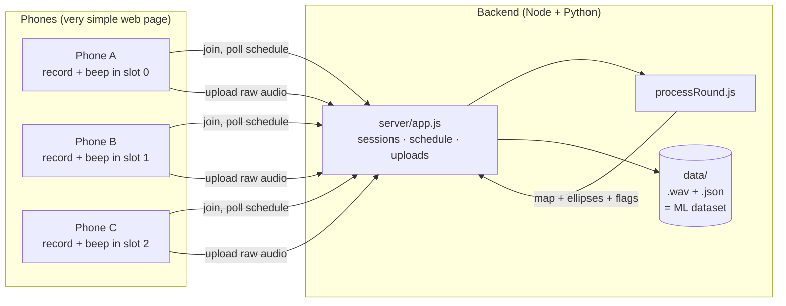
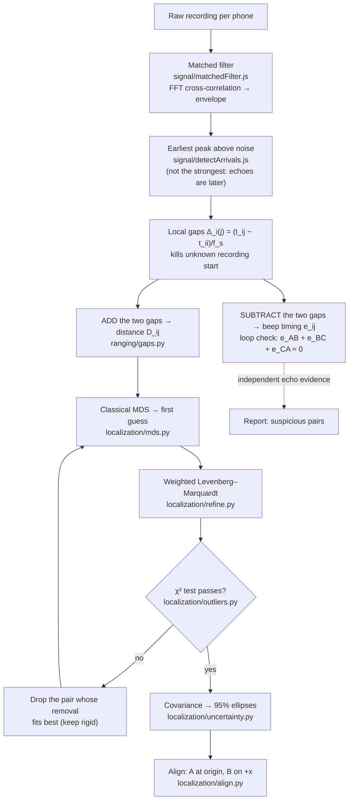
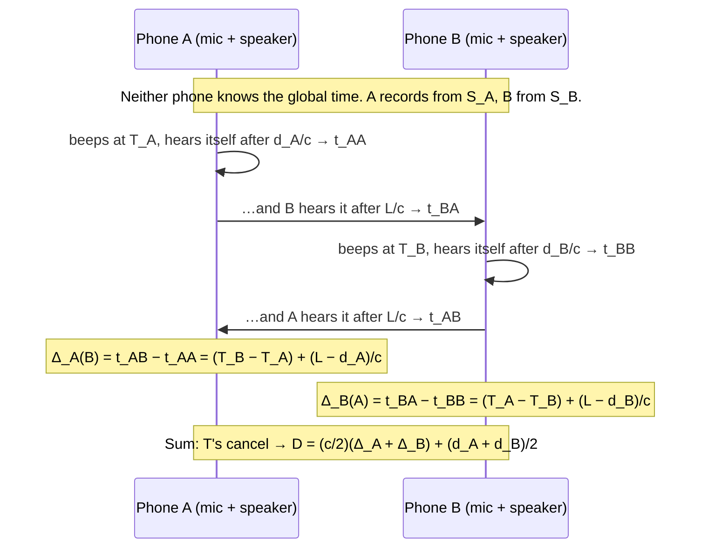

# phone-ranging

Phones beep at each other, and the backend works out where every phone is.

Every phone records audio while each phone plays one short chirp in its own time slot. The server uses those recordings to measure the distance between every pair of phones. It then turns the distance table into a 2D map with an error ellipse for each phone. Chirp detection is plain JavaScript (no npm packages) and runs in Node and in the browser. The geometry — linear algebra, ranging, and the map — is Python (`numpy`).

```
pip install -r backend/py/requirements.txt
npm test                      # JS signal + end-to-end, then the Python geometry tests
node backend/server.js        # API + phone page on http://localhost:8080
cloudflared tunnel --url http://localhost:8080   # HTTPS link for phones (mic needs HTTPS)
# host (laptop):  http://localhost:8080/frontend/host.html → shows the phone link, starts rounds, shows the map
#                 no phones? "Add simulated phones" runs the whole pipeline with fake ones
# phones:         open the link the host shows (https://….trycloudflare.com/?s=CODE) → name → Join
# lab (laptop):   http://localhost:8080/frontend/lab.html  → detection in the browser, map from the Python solver
```

No Node? `powershell -ExecutionPolicy Bypass -File scripts/serve-static.ps1`, then `http://localhost:8090/tests/index.html` for the signal tests. The lab and the map need the Node server and Python.

---

## The big picture



## The pipeline inside `processRound.js`



## Why the timing cancels (the core trick)



Each phone only compares two moments **in its own recording**. That removes S. Adding the two phones' gaps removes T. No clock sync is needed, just a schedule loose enough that beeps don't overlap.

---

## Reading order (high level → low level)

| # | File | What you learn |
|---|------|----------------|
| 1 | [backend/processRound.js](backend/processRound.js) | The whole pipeline in ~60 lines |
| 2 | [backend/py/phone_ranging/ranging/gaps.py](backend/py/phone_ranging/ranging/gaps.py) | Gaps → distance (add), gaps → timing (subtract), loop check, σ from SNR |
| 3 | [backend/py/phone_ranging/localization/solve.py](backend/py/phone_ranging/localization/solve.py) | Distances → map, the 5 steps |
| 4 | [backend/py/phone_ranging/localization/mds.py](backend/py/phone_ranging/localization/mds.py) | Double-centering and why the eigenvectors are coordinates |
| 5 | [backend/py/phone_ranging/localization/refine.py](backend/py/phone_ranging/localization/refine.py) | Residuals, Jacobian, normal equations, LM damping |
| 6 | [backend/py/phone_ranging/localization/outliers.py](backend/py/phone_ranging/localization/outliers.py) | χ² test, redundancy, rigidity, why "largest residual" fails (masking) |
| 7 | [backend/py/phone_ranging/localization/uncertainty.py](backend/py/phone_ranging/localization/uncertainty.py) | Covariance from the pseudo-inverse and error ellipses |
| 8 | [backend/py/phone_ranging/localization/align.py](backend/py/phone_ranging/localization/align.py) | What distances can't tell you (slide/spin/mirror) |
| 9 | [backend/signal/chirp.js](backend/signal/chirp.js), [matchedFilter.js](backend/signal/matchedFilter.js), [detectArrivals.js](backend/signal/detectArrivals.js) | Chirps, correlation, envelope, earliest-peak rule, sub-sample interpolation |
| 10 | [backend/py/phone_ranging/ranging/drift.py](backend/py/phone_ranging/ranging/drift.py) | Clock drift: size of the error and how to measure it |
| 11 | [backend/py/phone_ranging/math/linalg.py](backend/py/phone_ranging/math/linalg.py), [signal/fft.js](backend/signal/fft.js) | numpy solve / eigen / pseudo-inverse, and the FFT by hand |
| 12 | [backend/simulate.js](backend/simulate.js) | How the fake phones and rooms are generated |
| 13 | [backend/server/app.js](backend/server/app.js), [server.js](backend/server.js) | The API and how a round is scheduled |
| 14 | [frontend/index.html](frontend/index.html) (phone), [host.html](frontend/host.html), [common.js](frontend/common.js), [style.css](frontend/style.css) | Mic set-up, clock sync, beep scheduling on the audio clock, upload; host controls and map drawing |

## API

| Method | Path | Body → Response |
|---|---|---|
| GET | `/api/time` | → `{ serverTime }` (phones estimate their clock offset) |
| POST | `/api/sessions` | → session |
| POST | `/api/sessions/:sid/join` | `{ name, model, selfDistance }` → `{ phone: { id, slot } }` |
| PUT | `/api/sessions/:sid/labels` | any JSON (room, true positions, orientation…) saved with every later round |
| POST | `/api/sessions/:sid/rounds` | `{ band, slotSeconds, temperatureC, anchors }` → schedule |
| POST | `/api/sessions/:sid/rounds/:r/upload` | `{ phoneId, sampleRate, samplesBase64 }` (little-endian Float32) |
| GET | `/api/sessions/:sid/rounds/:r` | → `{ status, result: { distances, loops, layout, … } }` |
| POST | `/api/solve` | `{ distances: [{a,b,d,sigma}], options }` → layout (no audio) |
| POST | `/api/finish` | `{ phones, gaps, selfDistances, bandwidthHz, … }` → distances, loops, layout |
| POST | `/api/procrustes` | `{ estimate, truth }` → overlay + RMSE |

## What the tests show (simulated)

| Scenario | Result |
|---|---|
| 5 phones, 2 cm distance noise, solver only | ~2 cm position RMSE, nothing dropped |
| 40 cm echo on one pair (6 phones) | Correct pair dropped, 1.2 cm RMSE (6.2 cm if not dropped) |
| Raw audio, clean or with wall echoes | sub-mm |
| Raw audio, one direct path shadowed −40 dB → echo lock (+2.3 m) | Loop check flags C–E in 4 loops, χ² stage drops C–E, map recovers |
| 50 ppm sample-rate mismatch | 2.6 mm |

⚠ **The audio simulator treats each phone as a single point** (speaker and mic in the same place, identical both ways), and its room has one perfect wall. The sub-mm numbers are a best-case check that the math and code are right. They are **not** a prediction. On real phones, expect centimetre-level error from phone size, orientation and multipath. Measuring that is what [docs/TEST_METHODOLOGY.md](docs/TEST_METHODOLOGY.md) is for.

## Docs

- [docs/PINGING_SYSTEM_PLAN.md](docs/PINGING_SYSTEM_PLAN.md): how the phones, the simple frontend and the backend fit together, and the build order
- [docs/TEST_METHODOLOGY.md](docs/TEST_METHODOLOGY.md): ideal-environment data collection and testing before any ML
