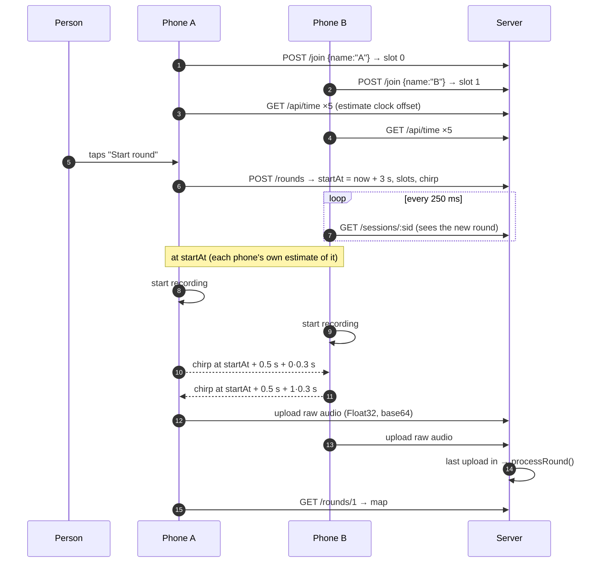
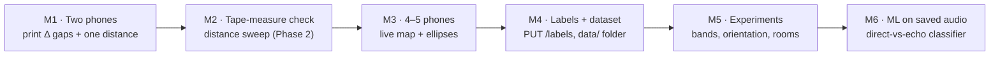

# Pinging system plan

**Design rule: dumb phones, smart server.** A phone does three things: play a chirp at a scheduled time, record, and upload the raw audio. All the math runs on the server. This keeps the frontend tiny, means a better detector can be re-run on old recordings, and gives us every raw recording for the ML dataset for free.

| Piece | Status | Where |
|---|---|---|
| Localization (distances → map) | ✅ done, tested | `backend/py/phone_ranging/localization/` |
| Ranging math (gaps → distances, loop check, drift) | ✅ done, tested | `backend/py/phone_ranging/ranging/` |
| Signal processing (chirp, matched filter, peak picking) | ✅ done, tested on simulated audio | `backend/signal/` |
| Session / schedule / upload API | ✅ done, tested in-process | `backend/server/app.js` |
| Node HTTP wrapper + saving .wav/.json | ✅ done, tested over real HTTP | `backend/server.js` |
| Lab page (simulated phones → real backend → map) | ✅ done | `frontend/lab.html` |
| **Phone page** | ✅ built to the spec below; flow tested with a fake mic, **not yet on real phones** | `frontend/index.html` |
| **Host page** (session link, phone list, start round, map; can add simulated phones) | ✅ done, tested with simulated phones | `frontend/host.html` |

> Since the split into host and phone views, **rounds are started from the host page**. Phones only join, beep, record and upload, and they show a short "how well did I hear" report. The wireframe below still shows the earlier single-page version with a Start button on the phone.
| Double-beep drift measurement in the schedule | ⬜ later (drift is ~mm, see `drift.py`) | |

---

## One round, end to end



**Why sloppy timing is fine.** Each phone's clock offset is only known to ±10–50 ms. That doesn't matter: the math cancels both the unknown recording start (S_i) and the unknown beep time (T_j). The schedule only needs to (1) keep beeps from overlapping, and (2) put each beep inside its search window, which is expected ±50/80 ms in `detectArrivals.js`. The search window there is −150/+200 ms, which covers network sync error plus Android's up-to-~150 ms speaker latency, and that's why slots are 500 ms apart.

**Latency also cancels.** Output latency (speaker) shifts when phone j's beep *really* leaves, which is just part of T_j. Input latency (mic) shifts every arrival in phone i's recording by the same amount, so it drops out of the gap t_ij − t_ii. Neither needs calibrating.

---

## Phone page spec (`frontend/index.html`, to build)

```
┌──────────────────────────────┐
│  Phone ranging               │
│  Session: [ k3f9 ] [Join]    │   ← or ?s=k3f9 in the URL (QR code from the lab)
│  Name:    [ A    ]           │
│  ─────────────────────────── │
│  Status: waiting · 4 phones  │
│  [  Start round  ]           │   ← any phone can start
│  ─────────────────────────── │
│  Round 3: done ✓             │
│   (tiny SVG map, same draw() │
│    code as lab.html)         │
└──────────────────────────────┘
```

Steps the page runs, in order:

1. **Join.** `POST /join` with name, `navigator.userAgent` as the model, and `selfDistance` (from a per-model table; 0.12 m default).
2. **Unlock audio on a tap.** iOS and Android only allow an `AudioContext` and the mic after a user gesture, so the Join button does it:
   ```js
   const ctx = new AudioContext({ sampleRate: 48000 });
   const stream = await navigator.mediaDevices.getUserMedia({ audio: {
     echoCancellation: false, noiseSuppression: false, autoGainControl: false, channelCount: 1 } });
   ```
   **All three processing flags must be off.** Echo cancellation would literally subtract our own beep.
3. **Clock offset.** Call `GET /api/time` 5 times and keep the reply with the shortest round trip: `offset = serverTime − (sent + received)/2`.
4. **Poll** `GET /sessions/:sid` every 250 ms. When a new round appears, compute `localStart = schedule.startAt − offset`.
5. **At localStart**, start recording. Use an `AudioWorklet` that copies input frames into a Float32 buffer (`ScriptProcessorNode` is a deprecated but simpler fallback).
6. **Schedule the chirp on the audio clock**, not with `setTimeout`, so it's sample-accurate relative to the recording:
   ```js
   const buf = ctx.createBuffer(1, chirp.length, ctx.sampleRate); buf.copyToChannel(Float32Array.from(chirp), 0);
   const src = ctx.createBufferSource(); src.buffer = buf; src.connect(ctx.destination);
   src.start(ctx.currentTime + leadInS + mySlot * slotSeconds);
   ```
   Generate `chirp` with the same `makeChirp()` from `backend/signal/chirp.js`. The browser can import it directly.
7. **After `recordSeconds`**, stop and `POST /upload` with `{ phoneId, sampleRate: ctx.sampleRate, samplesBase64, meta: { userAgent, volume } }`. Use `float32ToBase64` from `backend/server/wav.js`.
8. **Poll** `GET /rounds/:r` until `done`, then draw the map.

Practical gotchas:
- **HTTPS is required for the mic** (except on localhost). For phones on Wi-Fi, run `node backend/server.js` and put an HTTPS tunnel in front of it.
- Request a **Screen Wake Lock** so the phone doesn't sleep mid-round.
- **Disconnect Bluetooth audio.** Its latency doesn't break the math, but the beep would come out of the wrong place.
- Set **media volume to a fixed level** (the methodology uses 75%), and turn Do Not Disturb on.
- If `ctx.sampleRate` isn't 48000 (some Androids force 44100), just send the real rate. The server builds the template at whatever rate it receives.

---

## Build order



- **M1:** the phone page with steps 1–8, tested with 2 phones. The server returns per-pair `distances` even when there are too few phones for a map (`layoutError` explains why).
- **M2:** Phase 2 of the methodology. If the slope and offset match the predictions, the whole chain is validated.
- **M3:** 4+ phones gives the first redundancy (χ² test), 5+ lets the system identify which pair is bad.
- **M4:** a small form in the lab or phone page that sends `PUT /labels` with room, true positions and orientation. Every round's `.json` then carries its ground truth.
- **M5–M6:** see the methodology.
