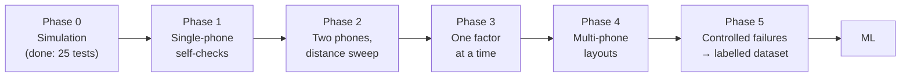

# Test methodology: ideal environment first, no ML

**Goal.** Before any ML, prove that the physics-and-math pipeline works as predicted under the best possible conditions. Then add one difficulty at a time. Every experiment should either confirm a prediction from the math or measure a number we need, such as bias, noise, or the SNR below which readings can't be trusted.

**Rule for every phase: change one thing, hold everything else fixed, and record everything.**



Each phase has a **gate**: don't move on until it passes. If a gate fails, the bug is in the phase you're on, not in some later complication.

---

## The "ideal environment"

| Factor | Ideal setting | Why |
|---|---|---|
| Space | Large open area: an outdoor field, an empty gym, or a big lecture hall. ≥ 3 m from any wall | The first wall echo arrives ≥ 6 m of extra path late, far outside the peak |
| Height | Phones on stands or boxes **1.0–1.2 m** above the floor, screen up, speaker edge facing the other phone | Floor bounce is then ≥ 47 cm of extra path at 4 m, and much more at short range, well beyond the 8.6 cm resolution of a 4 kHz chirp. Phones flat on a table also get a table echo |
| Orientation | Facing each other (speakers pointed at each other's mics) | No body shadowing, strongest direct path |
| Noise | < 40 dBA (check with any SPL app), no HVAC blast, no talking during rounds | SNR |
| Wind | Indoors, or < 10 km/h outside | Wind changes the effective speed of sound along the path |
| Temperature | Measure it at the start and end of each session | 1 °C error ⇒ 0.17 % scale error (1.7 mm per metre) |
| Phones | Same two models throughout a phase, cases off, 75 % media volume, Do Not Disturb, Bluetooth off, battery > 50 % | Removes phone-to-phone variation |
| People | Stand ≥ 1 m behind the phones and stay still during a round | Bodies are good reflectors |

**Ground truth.** Use a tape measure (or a laser measure if available). Define each phone's reference point as the **center of the phone**, marked with tape on the stand, and use it the same way every time. A phone is ~15 cm long, so expect a ~cm-level ambiguity in what "phone position" even means. Phase 2 measures that ambiguity as an offset.

---

## Phase 0: Simulation (done)

`node tests/run-node.js`, or `tests/index.html` in a browser. These tests confirm that the formulas, solver, outlier rejection and API are correct on data with known answers.

**Before every session:** re-run the tests and record the git commit in the session log, so you know exactly which code produced which data.

**Gate:** all tests pass.

## Phase 1: Single-phone self-checks (15 min per phone model)

Run 10 normal rounds with the phone under test plus any partner phone 1 m away. Only look at the phone under test's own-beep numbers in `result.json`.

| Check | How | Expect |
|---|---|---|
| Real sample rate | Recording `.json` → `sampleRate` | 48000 or 44100, and constant across rounds |
| Own-beep SNR | `detections[id].ownSnrDb` | > 40 dB. If lower, a processing flag (echo cancellation, AGC) is still on |
| Background noise | `detections[id].noiseFloor` | Stable within a few dB between sessions |
| Speaker→mic distance d_i | Ruler, speaker grille to mic hole | Record per model, used in D_ij = … + (d_i + d_j)/2 |
| Clipping | `detections[id].maxAbsSample` | < 0.9. If it clips, lower the volume (clipping distorts the chirp) |
| Own beep really own | `detections[id].own`: `marginDb`, `scheduleOffsetS`, `wrongSlot` | margin > 6 dB, offset a few tens of ms (speaker + mic latency) and the same every round. `wrongSlot` → another beep was taken as own, which causes negative or wild distances |
| Mic stream intact | `detections[id].droppedBlocks`, `micSettings` | No gaps; echoCancellation / noiseSuppression / autoGainControl all `false`. Compare round #1 with later rounds (`roundsTaken`) |

**Gate:** own-beep SNR > 40 dB with no clipping on every phone.

## Phase 2: Two phones, distance sweep (the most important phase)

**Setup:** ideal environment, facing each other, `2-6k` band.
**Distances:** 0.25, 0.5, 1, 1.5, 2, 3, 4 m (tape-measured, center to center).
**Repeats:** 20 rounds per distance, then **swap the two phones** and do 20 more at 1 m and 3 m to check symmetry.

That's 7 × 20 + 2 × 20 = 180 rounds. At ~3 s per round plus moving, it takes about 45 minutes.

**Analysis.** Fit a straight line, measured = a · true + b:

| Parameter | Prediction | What a mismatch means |
|---|---|---|
| Slope a | 1.000 ± 0.002 | c is wrong. Check the temperature input. A slope of 1.003 is ~2 °C off |
| Offset b | A few cm, constant | Geometry: speaker and mic aren't at the "center". **Becomes a per-model calibration constant** |
| Residual std (per distance) | Grows slowly with distance (SNR falls ~6 dB per doubling) | A jump at one distance usually means a floor or table echo at that geometry |
| Swap test | Same result both ways | If not, the phones differ (d_i, latency). Check Phase 1 |
| Loop check | n/a (needs 3 phones) | |

Also plot **SNR vs. distance**. It should fall ~6 dB per doubling of distance (1/r spreading).

**Gate:** after subtracting the fitted offset b, |bias| < 1 cm and std < 5 mm at every distance ≤ 2 m, and 100 % of beeps detected.

## Phase 3: One factor at a time (2 phones)

Start from the Phase 2 baseline (1 m and 2 m, facing, `2-6k`, 1.1 m high). Change **only one** factor per block, with 10 repeats each:

| Factor | Levels | Question it answers |
|---|---|---|
| Frequency band | 1-3k, 3-6k, 6-10k, 10-14k, 14-17k, 17-21k | Which bands survive (SNR, std, detection rate)? |
| Orientation | 0° (facing), 90° (side-on), 180° (back-to-back) | How much does body shadowing cost, per band? |
| Height | On the floor, on a table (phone flat), on a stand | How much do floor and table echoes hurt? |
| Volume | 25, 50, 75, 100 % | Where does SNR saturate or clip? |
| Phone model | Every model the group owns | Per-model offset b and d_i |

Expected results to check:
- High bands lose much more at 180° than low bands (diffraction: 17 cm wavelength at 2 kHz vs 1.7 cm at 20 kHz).
- Error jumps once SNR drops below some threshold. **Find that threshold:** it becomes the "too weak to trust" cutoff in `detectArrivals.js` (`minSnrDb`).

That's 6 bands × 3 orientations × 2 distances × 10 repeats = 360 rounds for the main grid. Height, volume and model add ~100 more.

**Gate:** you can state which band to use by default and the SNR cutoff, with plots to back it up.

## Phase 4: Multi-phone layouts (ideal room)

Use 5 phones, the minimum that can both detect *and* identify a bad pair. Tape these layouts on the floor:

| Layout | Shape | Tests |
|---|---|---|
| L1 "square + center" | 2 m square, 5th phone in the middle | Normal case: should give the best accuracy |
| L2 "line" | 5 phones in a row, 0.75 m apart | Collinear stress test: ellipses should be long and thin sideways |
| L3 "spread" | Irregular, 1–4 m pairs | Typical real use |

For each layout:
1. Tape-measure **all 10 pairwise distances** as ground truth for pairs, and record true positions.
2. Send `PUT /labels` with `{ phase: 4, layout, truePositions, room, tempC }`.
3. Run 20 rounds.
4. **Rotate the phones** among the positions (A→B→C→D→E→A) and run 20 more. This separates phone-specific bias from position effects.

| Metric | Computed from | Target (ideal room) |
|---|---|---|
| Pair error | `distances[].d` vs taped pair distance | Matches Phase 2 bias and std |
| Position RMSE | `layout.phones` vs truth, after Procrustes overlay (`align.js`) | < 3 cm for L1 |
| Loop closure | `loops.triangles[].closure` | Distribution centered at 0. Its width sets `loopThresholdS` |
| χ² calibration | `stats.cost / stats.dof` averaged over rounds | ≈ 1. If ≫ 1, our σ's are too optimistic, so raise the floor in `distanceSigma` |
| Ellipse honesty | Fraction of true positions inside the 95 % ellipse | ≈ 95 % |
| False drops | `layout.dropped` in this clean room | ≈ 1 % of rounds (the χ² test is set to 99 %) |

**Gate:** L1 position RMSE < 3 cm, cost/dof between 0.5 and 2, false drops ≤ 2 %.

## Phase 5: Controlled failures, which become the labelled dataset

Now break things **on purpose, one at a time**, with full ground truth. Because every true distance is known, each detection can be labelled automatically:

> pair error > 5 cm and positive → **echo lock** · otherwise → **direct path**

That's the training label for the "direct vs. echo" model, collected without hand-labelling anything.

| Perturbation | How | Expected failure |
|---|---|---|
| Reflector | Whiteboard or door 0.5–1 m beside one pair | Strong echo, mostly harmless if the direct path is OK |
| Shadowing | Turn one phone 180° | Direct path weakens, may lock onto the echo |
| Blocker | Person or backpack between two phones | Direct path blocked |
| Small hard room | Dorm room, hallway | Many strong echoes |
| Combination | 180° + near a wall | Worst case: guaranteed echo locks |

For each condition, use the L1 layout and 20 rounds. Record which pair(s) were perturbed in the labels.

**Measures of the non-ML pipeline (this is the baseline any ML has to beat):**
- Detection: % of perturbed pairs that the loop check flags, and % that the χ² stage drops.
- False alarms: % of clean pairs dropped.
- Final position RMSE with and without outlier rejection (`options.maxDrops: 0`).

---

## What to record

The server saves this automatically (`backend/server.js`):

```
data/<session>/round<N>/
  A.wav  A.json   ← raw audio + { sampleRate, labels, phone, schedule, meta }
  B.wav  B.json
  …
  result.json     ← distances, loops, layout, everything processRound returned
```

The labels you send with `PUT /api/sessions/:sid/labels` (example):

```json
{
  "phase": 4, "layout": "L1", "room": "gym-north", "tempC": 21.5, "noiseDbA": 34,
  "band": "2-6k", "volume": 0.75, "heightM": 1.1,
  "truePositions": { "A": [0, 0], "B": [2, 0], "C": [2, 2], "D": [0, 2], "E": [1, 1] },
  "orientation": { "A": 0, "B": 0, "C": 0, "D": 0, "E": 0 },
  "perturbation": null,
  "gitCommit": "abc1234", "operator": "J", "notes": ""
}
```

Also keep a **paper or spreadsheet session log**, one line per block: time, phase, block, condition, rounds, anything odd ("door opened during round 12"). The log is what lets you throw out bad rounds honestly instead of guessing.

## How many repeats?

A standard deviation estimated from N repeats is uncertain by about 1/√(2(N−1)):

| N | Uncertainty in std | Use |
|---|---|---|
| 10 | ±24 % | Factor screening (Phase 3) |
| 20 | ±16 % | Calibration (Phase 2, 4) |
| 30 | ±13 % | Final numbers you'll quote |

The bias 95 % confidence interval is ±2·std/√N. With std = 5 mm and N = 20 that's ±2.2 mm, which is fine for a 1 cm gate.

## Roles (4 people)

| Role | Does |
|---|---|
| Operator | Runs rounds, watches status, decides when to re-run |
| Measurer | Tape measure, moves phones, checks the marks before each block |
| Logger | Session log, `PUT /labels` before each block, temperature and noise readings |
| Quiet-keeper | Keeps people still and quiet, watches for doors and HVAC. Swap roles each phase |

## Analysis checklist (per phase)

1. Error vs. true distance, one line per band or orientation (Phases 2–3).
2. SNR vs. distance on a log x-axis, which should be roughly a straight line (−6 dB per doubling).
3. Scatter of SNR vs. |error|, used to pick the cutoff.
4. Heatmap of error by band × distance, one per orientation (Phase 3).
5. Map overlays with true vs. estimated positions and ellipses (`frontend/lab.html` draws these from real `result.json` with small changes).
6. Histogram of loop closures, and cost/dof over rounds (Phase 4).
7. Confusion table of perturbed pairs vs. flagged or dropped pairs (Phase 5).

## Things that will quietly ruin data

- Phone moved between the tape measure and the round. Re-check the marks before each block.
- AGC or noise suppression silently re-enabled after an OS update. Phase 1's own-beep SNR catches this, so re-run it each session.
- Temperature left at the default 20 °C in a 28 °C room: 1.3 % scale error, 4 cm at 3 m.
- Someone talking or walking during a round. Note it in the log and drop that round.
- Mixing phone models between blocks without recording it.
